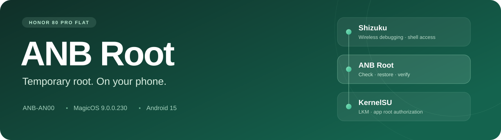
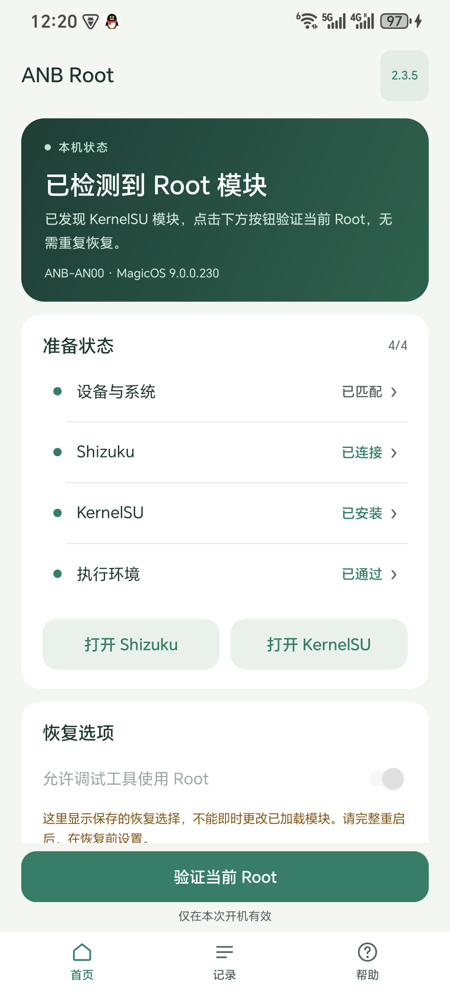
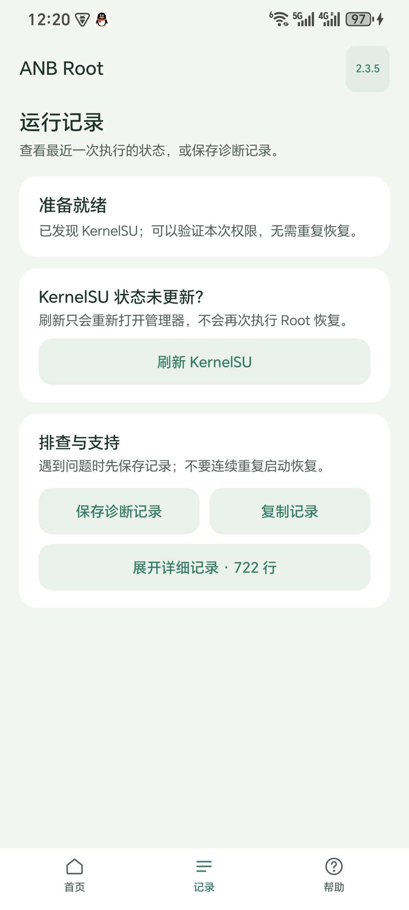
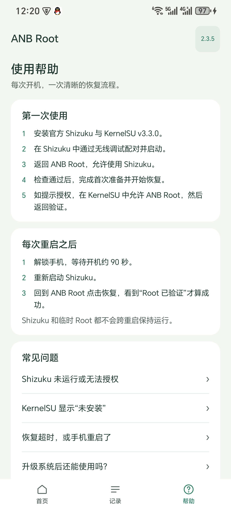
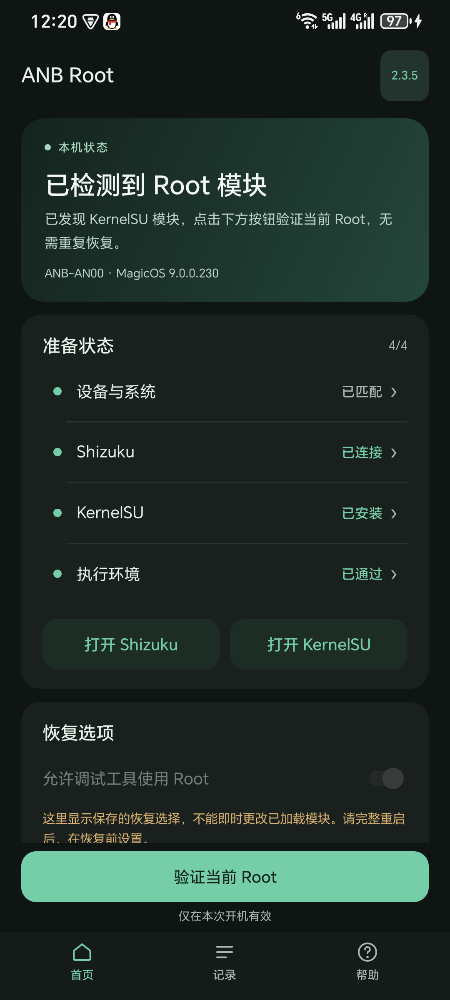

# ANB Root

**On-device temporary root for HONOR 80 Pro Flat** ANB-AN00 · Shizuku · KernelSU LKM

   

**[Download 2.4.0 APK](https://github.com/Chuniex-0631/honor-anb-an00-root/releases/download/v2.4.0/ANB-Root-2.4.0.apk)** · [Release notes](https://github.com/Chuniex-0631/honor-anb-an00-root/releases/tag/v2.4.0) · [Documentation](docs/README.md) · [简体中文](README.md)

Start Shizuku through wireless debugging, grant ANB Root permission, and let the app run the adapted GhostLock recovery flow and load the device-specific KernelSU module. **The established recovery workflow runs on the phone without a computer.**

> **Check compatibility first.** Only the exact ANB-AN00 firmware and kernel below are supported. The ANP-AN00 curved variant is excluded. A full reboot clears temporary root: restart Shizuku, then restore through the app. This project does not unlock the bootloader.

> **2.4.0 uses a new release signing certificate.** Versions 2.3.5 and earlier must be uninstalled before installing 2.4.0. Export diagnostics first. If root is active or recovery was attempted during the current boot, fully reboot before uninstalling the old app and setting up the new one. Do not clear app data or uninstall during recovery. Reconfigure ANB Root options and grant Shizuku/KernelSU access again; Shizuku and KernelSU themselves do not need to be uninstalled. Later releases using the 2.4.0 certificate can be installed as upgrades. See the [migration guide](docs/USER_GUIDE.md#从旧版迁移到-240).

## A guided recovery workflow

| Feature | What it provides |
|---|---|
| Prerequisite checks | Device, Shizuku, KernelSU and the actual execution environment |
| Recovery and verification | Five-stage progress; verification of existing modules without another recovery |
| Permission choice | Debugging-tool root is off by default, with an explicit confirmation before enabling |
| Records and help | Local diagnostics, user-directed export, manager refresh and reboot instructions |
| Adaptive interface | Text-only header, dark mode, large fonts, landscape and full-width list feedback |

The app uses **Shizuku UserService** for shell access. It has no fixed TCP 5555 ADB client, imports no desktop ADB private key and requests no Internet permission. Environment and verification summaries are kept in the app-specific local directory; manual exports go to a location you choose and are not uploaded automatically.

## Historical interface reference (2.3.5)

 
Home · Records · Help | Historical 2.3.5 captures from ANB-AN00; these are not 2.4.0 screenshots

Historical dark mode and 2.3.5 highlights

Full-width row feedback; accurate checking, manager-refresh and recovery states; repeated-task progress fixes; single-owner dialogs; export guards; large-font and landscape layouts. See the [UI audit](docs/AUDIT_2.3.5.md) and [changelog](CHANGELOG.md).

## Supported target

| Requirement | Supported configuration |
|---|---|
| Device | **HONOR 80 Pro Flat / ANB-AN00 (HNANB)** |
| System | Android 15 · MagicOS **9.0.0.230** |
| Full firmware | `ANB-AN00 9.0.0.230(CHNC00E230R2P5)` |
| Kernel | `5.10.236-android12-9-gd671cf8c2b02` |
| Shizuku | Official 13+, started in shell mode through wireless debugging |
| KernelSU | Manager **v3.3.0** and the bundled Honor-specific LKM |

Model, SDK, full firmware and kernel must all match. A shared SoC or similar version number does not establish compatibility. [Full requirements →](docs/COMPATIBILITY.md)

## Get started

1. Install the [2.4.0 APK](https://github.com/Chuniex-0631/honor-anb-an00-root/releases/download/v2.4.0/ANB-Root-2.4.0.apk); versions 2.3.5 and earlier require uninstalling the old app first as described above. Verify it against [SHA256SUMS.txt](https://github.com/Chuniex-0631/honor-anb-an00-root/releases/download/v2.4.0/SHA256SUMS.txt).
2. Install official [Shizuku](https://shizuku.rikka.app/download/) and [KernelSU v3.3.0](https://github.com/tiann/KernelSU/releases/tag/v3.3.0).
3. Pair and start Shizuku through wireless debugging, then grant ANB Root Shizuku access.
4. Unlock and wait about 90 seconds after boot. Pass the checks, complete initial setup and follow the recovery prompt. A loaded module with a matching current-boot record only needs verification; missing records require a full reboot as instructed.
5. If requested, grant ANB Root access in KernelSU → Superuser, then return to verify. Completion requires the app's verified-root result.

**After every full reboot: unlock and wait → start Shizuku → restore with ANB Root.** Revoking pairing or disabling developer options requires restoring Shizuku's startup conditions first.

Should I allow debugging tools to use Root?

Leave it off for ordinary use. Enabling it automatically allows shell tools such as ADB and Shizuku to request root; ordinary apps remain individually managed by KernelSU.

The choice is saved across upgrades using the same new certificate and used when a new recovery loads the module. Uninstalling the old-signature app resets this choice. It cannot be changed during recovery or applied instantly to a loaded module: fully reboot, change the option, then restore. Turning it off does not revoke other existing KernelSU grants. See the [user guide](docs/USER_GUIDE.md).

## Help and validation

If KernelSU shows stale state after root was verified, use **Records → Refresh KernelSU**. If recovery times out or disconnects, save diagnostics and follow the guidance; avoid repeated launches.

[Troubleshooting](docs/TROUBLESHOOTING.md) · [Report a problem](https://github.com/Chuniex-0631/honor-anb-an00-root/issues/new/choose) · [Security reports](SECURITY.md)

Version 2.4.0 revises recovery, verification, error handling and UI state transitions, including missing records, authorization changes, concurrent tasks and callbacks after leaving the app. The original payloads and AIDL remain byte-for-byte unchanged. Successful verification now requires the original loader's initialization and cleanup markers plus live protection-state checks; a loaded module or `uid=0` alone does not establish complete success.

See the [2.4.0 audit and validation](docs/AUDIT_2.4.0.md) for device results, automated checks and remaining boundaries. Historical device success does not prove all new control paths or module combinations. The race-based recovery and unexpected power loss cannot be guaranteed to succeed. Version and certificate metadata are recorded in the [current release manifest](release/current.json).

## Documentation and source

| Area | Documentation |
|---|---|
| Usage | [Documentation index](docs/README.md) · [User guide](docs/USER_GUIDE.md) |
| Development | [Build](docs/BUILD.md) · [Architecture](docs/ARCHITECTURE.md) · [Contributing](CONTRIBUTING.md) |
| Validation | [2.4.0 audit and validation](docs/AUDIT_2.4.0.md) · [Validation](docs/VALIDATION.md) · [2.3.5 UI audit](docs/AUDIT_2.3.5.md) · [2.3.3 code audit](docs/AUDIT_2.3.3.md) |
| Research | [History](docs/research/RESEARCH_HISTORY.md) · [Evidence](docs/EVIDENCE_MANIFEST.md) · [Privacy](docs/PRIVACY.md) |

## Credits and license

Built on existing [GhostLock-H80GT](https://github.com/yakidango-official/GhostLock-H80GT) research, with [Shizuku](https://github.com/RikkaApps/Shizuku) and [KernelSU](https://github.com/tiann/KernelSU). Thanks also to [NebuSec / CyberMeowfia](https://github.com/NebuSec/CyberMeowfia) and [Magisk](https://github.com/topjohnwu/Magisk). Original research and payload attribution remain with their authors.

App-owned source is **[Apache-2.0](LICENSE)**. Dependencies and payloads retain their licenses, including GPL-2.0 for relevant KernelSU components. See [NOTICE](NOTICE) and [third-party sources](docs/THIRD_PARTY.md).
