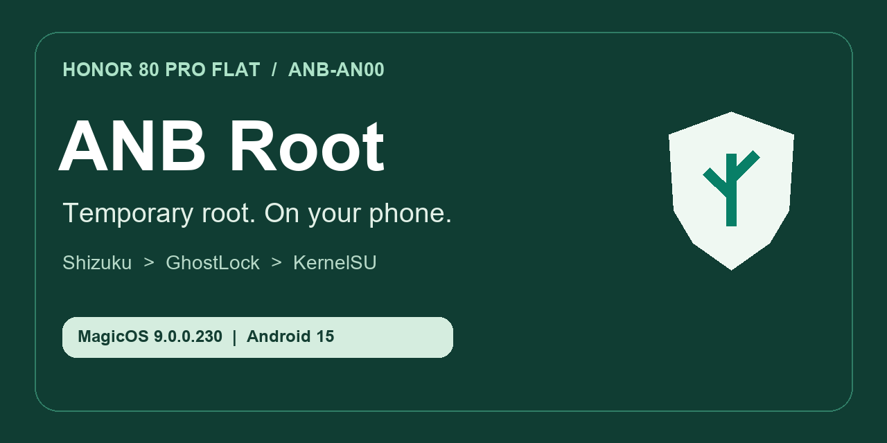
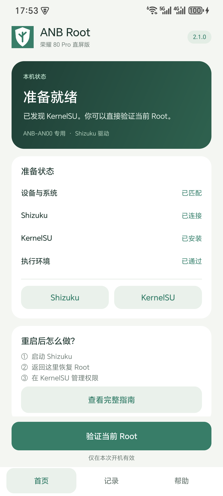
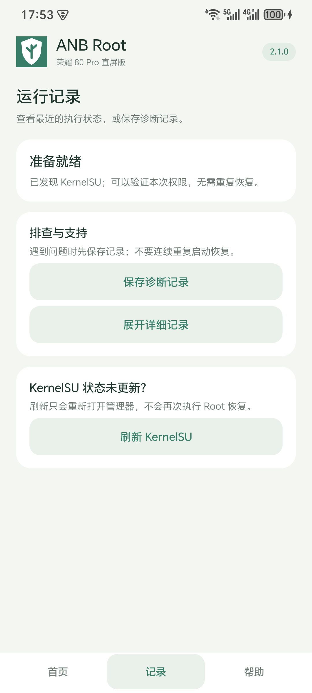
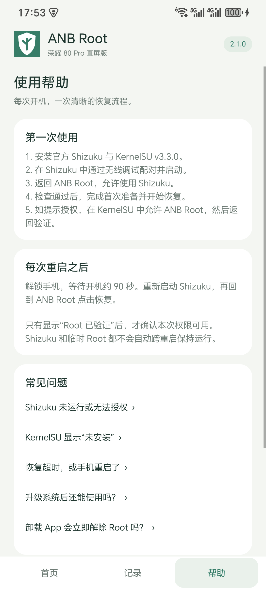

# ANB Root · 荣耀 80 Pro 直屏版临时 Root

**HONOR 80 Pro Flat / ANB-AN00 · Shizuku · GhostLock · KernelSU LKM**

[**下载 APK**](https://github.com/Chuniex-0631/honor-anb-an00-root/releases/latest) · [使用指南](docs/USER_GUIDE.md) · [兼容范围](docs/COMPATIBILITY.md) · [English](README.en.md)

ANB Root 是面向 **荣耀 80 Pro 直屏版 ANB-AN00** 的 Android 临时 Root 工具。先在手机上通过无线调试启动 Shizuku，再由 App 完成已适配的 GhostLock 恢复链和 KernelSU 模块加载；日常恢复不需要连接电脑。

**仅适配下表中的已验证系统。Root 在完整重启后失效，需要重新启动 Shizuku 并恢复；本项目不解锁 Bootloader，也不提供永久 Root。**

## 兼容范围

| 项目 | 已验证组合 |
|---|---|
| 设备 | HONOR 80 Pro Flat / 荣耀 80 Pro 直屏版 / **ANB-AN00（HNANB）** |
| 系统 | Android 15 · MagicOS **9.0.0.230** |
| 固件 | `ANB-AN00 9.0.0.230(CHNC00E230R2P5)` |
| 内核 | `5.10.236-android12-9-gd671cf8c2b02` |
| 执行环境 | 官方 Shizuku 13+，无线调试启动的 shell 模式 |
| 管理器 | KernelSU **v3.3.0**；随工具提供的荣耀定制 LKM |
| 启动状态 | 实测 Bootloader locked / AVB green；完成后 SELinux Enforcing |

**ANP-AN00 曲屏版、其他荣耀机型与其他内核不在本次支持范围内。** 详细条件见 [兼容性说明](docs/COMPATIBILITY.md)。版本号、相同 config 或相同 SoC 本身不构成兼容证明。

## 快速开始

1. 从 [Releases](https://github.com/Chuniex-0631/honor-anb-an00-root/releases/latest) 下载 APK，按 [SHA-256](release/SHA256SUMS.txt) 核对文件。
2. 安装官方 [Shizuku](https://shizuku.rikka.app/download/) 和 [KernelSU v3.3.0](https://github.com/tiann/KernelSU/releases/tag/v3.3.0)。
3. 在 Shizuku 中通过**无线调试**完成配对并启动。返回 ANB Root，授予 Shizuku 权限。
4. 准备项检查通过后，点击“完成首次准备”，再点击“恢复 Root”。开机不足约 90 秒时先等待。
5. 如提示授权，在 KernelSU → 超级用户中允许 ANB Root，再返回验证。

以后每次完整重启：**解锁并等待启动完成 → 启动 Shizuku → 打开 ANB Root 恢复**。关闭开发者选项或撤销配对后，需要先在本机重新配置 Shizuku。

## 面向日常使用的界面

- **首页**：准备条件、进度、固定底部操作按钮。
- **记录**：本地诊断、文件导出、单独刷新 KernelSU。
- **帮助**：首次使用、重启流程、授权与常见问题。

App 只通过 **Shizuku UserService** 获取执行环境，没有内置 5555 ADB 客户端，不导入电脑私钥，也不申请联网权限。恢复任务串行执行；连接中断或超时不会自动启动第二条链路。

## 验证与边界

2026-10-31 已在 ANB-AN00 上验证临时 Root、KernelSU LKM 和重启后由手机独立恢复，机主随后再次重启并复验成功。2.1.0 是用户界面与发行包装更新：与已验证的 2.0.1 相比，**17 项核心输入、18 个核心编译类及执行组件声明一致**。

这属于指定设备与固件的实机验证，不是所有设备的通用成功率保证。竞态失败可能重启；不要并发或连续重复启动。见 [验证摘要](docs/VALIDATION.md) 和 [历史索引](docs/RESEARCH_HISTORY.md)。

## 常见问题

**KernelSU 显示“未安装”，但 App 已验证 Root？** 使用“记录 → 刷新 KernelSU”。本工具在加载前停止旧管理器、完成后重新打开，避免沿用加载前的进程。

**Shizuku 关闭或授权被撤销？** 在 Shizuku 中重新启动、配对或授权，再回到 App 检查。不是自动开机 Root。

**升级系统后还能用吗？** 只有设备与内核检查仍匹配时才会开放恢复；新系统需要重新验证适配。

更多内容见 [使用指南](docs/USER_GUIDE.md) 与 [故障排查](docs/TROUBLESHOOTING.md)。

## 开发与研究

- [构建说明](docs/BUILD.md)：Java 源码、AIDL、固定依赖和 Android 构建。
- [技术架构](docs/ARCHITECTURE.md)：Shizuku → 独立 shell 服务 → 恢复与验证。
- [研究历史](docs/RESEARCH_HISTORY.md)：基线、GKI 参考对照、临时 Root 路线及 App 化。
- [脱敏说明](docs/PRIVACY.md)：保留研究结论，排除个人标识、凭据与原始私人日志。
- [贡献指南](CONTRIBUTING.md) · [安全政策](SECURITY.md)。

## 致谢与许可

App 自有源码采用 [Apache-2.0](LICENSE)。内置载荷及依赖保留各自许可，尤其 KernelSU 相关组件的 GPL-2.0；见 [NOTICE](NOTICE) 和 [第三方来源](docs/THIRD_PARTY.md)。

感谢 [GhostLock-H80GT](https://github.com/yakidango-official/GhostLock-H80GT)、[NebuSec / CyberMeowfia](https://github.com/NebuSec/CyberMeowfia)、[Shizuku](https://github.com/RikkaApps/Shizuku)、[KernelSU](https://github.com/tiann/KernelSU) 与 [Magisk](https://github.com/topjohnwu/Magisk)。本项目封装并适配现有研究成果，不将上游漏洞发现归为原创。
