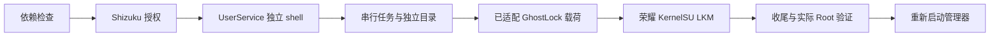

# 技术架构

普通 App 不能简单替代 ADB shell 环境，因此采用官方 UserService，检测 UID、上下文和 Seccomp。实现见 [RecoveryEngine](../app/java/com/anb/root/RecoveryEngine.java)、[ShizukuShell](../app/java/com/anb/root/ShizukuShell.java) 和 [ShellUserService](../app/java/com/anb/root/ShellUserService.java)。

每次开机保存记录并使用原子目录锁。超时／断开不代表内核载荷停止，不能启动第二条链路。完成判断结合本次日志、模块、Enforcing 和 App 实际 Root。

管理器加载前停止、完成后重新启动，保留 allow_shell=0。普通电脑 shell 不自动获得 Root。

App 集成与上游载荷分别归属。Google GKI 参考树不是 HONOR 生产源码；相同 config 不是二进制相同的证明。
