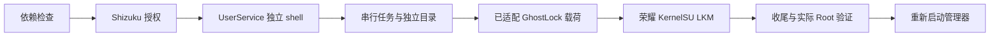

# 技术架构

普通 App 不能简单替代 ADB shell 环境，因此采用官方 UserService，检测 UID、上下文和 Seccomp。实现见 [RecoveryEngine](../app/java/com/anb/root/RecoveryEngine.java)、[ShizukuShell](../app/java/com/anb/root/ShizukuShell.java) 和 [ShellUserService](../app/java/com/anb/root/ShellUserService.java)。

每次开机保存记录并使用原子目录锁。超时／断开不代表内核载荷停止，不能启动第二条链路。完成判断结合本次日志、模块、Enforcing 和 App 实际 Root。

管理器加载前停止、完成后重新启动。2.2.0 由用户选择“允许调试工具使用 Root”，默认关闭；启动时读取一次并固定布尔值，传入原模板 `@ALLOW_SHELL@`（0 或 1）。8 个载荷原字节与其余模板参数不变。选项保存在 App 私有配置中，本次选择记入运行记录。

`allow_shell=1` 让 KernelSU 自动许可 UID 2000 的 Root 请求；关闭时沿用原模板不添加此参数的分支。已有模块或本次开机已有尝试时仍只验证／监控，不卸载、重载或修改模块。此参数不能运行中切换，需完整重启后设置。

实现依据：[KernelSU v3.3.0 allowlist](https://github.com/tiann/KernelSU/blob/v3.3.0/kernel/policy/allowlist.c) 与 [模块参数声明](https://github.com/tiann/KernelSU/blob/v3.3.0/kernel/core/init.c)。

App 集成与上游载荷分别归属。Google GKI 参考树不是 HONOR 生产源码；相同 config 不是二进制相同的证明。

## 2.3.3 执行控制

DeviceProfile 精确匹配机型、SDK、完整 display id 和内核，UI 与 worker 均验证。TaskGate 给检查、恢复、管理器及设置唯一租约，只有持有者能释放。Service 区分持有任务与重复请求。VERIFY／CHECK_PROGRESS 从私有 Intent 到引擎显式禁止新恢复，缺失 Intent 也默认禁止。

状态头采用固定字段和 DETAILS 边界，日志 tail 不能提供成功标记。目录的 boot 必须匹配当前记录；已有目录锁但没有有效记录时拒绝重跑。复验已加载模块会保留原目录。RecoveryFailure 提供错误种类，保护状态错误不依赖文本归类。

CommandRunner 只清理自己创建的短控制命令，永不笼统杀整个恢复进程组。Shizuku 关闭／超时／中断及迟到连接均有保护，UserService 版本更新以刷新旧缓存代码。

## 保留的上游副作用

原 loader 会执行 ksud 的 post-fs-data、services、boot-completed 等阶段，也会把运行时 `ro.product.locale.region` 标识改为 US，以兼容上游说明中的 LSPosed 解析问题。用户的显示语言与设置地区不因此自动改变，该标识在重启后恢复。本版没有修改这些继承行为。保护设置的临时放宽与最后恢复仍由原链路控制，失败后按提示保存记录并完整重启。
