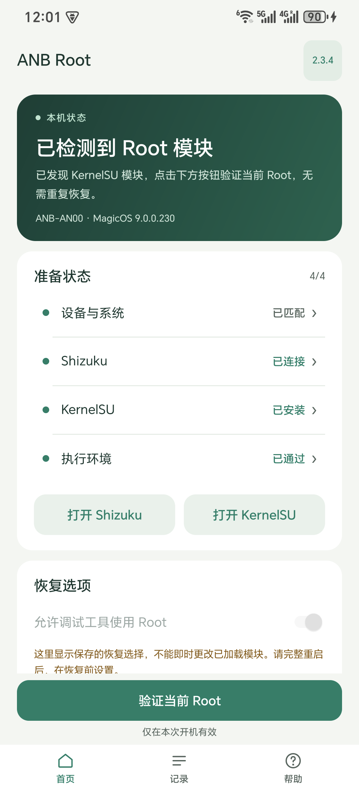
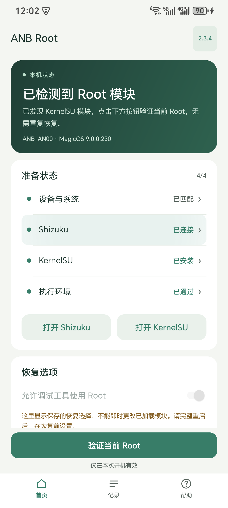

# 2.3.4 UI 审计与发布准备

日期：2026-11-02。基线：2.3.3（`bf65b95`）。本版完成 UI 审计后作为 2.3.4 正式版发布。

用户已在本会话报告 2.3.3 本机验证完成；未提供具体步骤、选项组合或新日志，因此这条确认单独记录，不据此推定所有故障场景和所有选项均已实测。

下图为真实设备的普通状态和持续按住 Shizuku 准备项时的画面；动态录像与其余帧保留在本机审计记录中。静态图只说明一个时刻，滑动取消和返回状态另行检查。

 

## 修复闭环

| 编号 | 发现与影响 | 修复及复核 |
|---|---|---|
| U01 | 首页准备项的遮罩只内缩 mask，边缘切过状态圆点；按住时反馈与整行内容不一致 | 透明内容层与圆角 mask 使用相同边界；整行增加内边距。四行逐一捕获按下早期、持续按住、松开和返回画面，另留动态录像；四行拖动取消均未误跳转 |
| U02 | 完成刷新可能撤销 tick 回调却保留 ticking 标志，使下一次任务无法更新进度 | 空闲渲染同时清除标志和回调；在真实 Activity 中连续取得、释放两次模拟恢复租约，检查每次 ticker 均启动和停止 |
| U03 | 检查环境／刷新 KernelSU 与恢复共用 busy，可能显示旧恢复阶段、恢复耗时和不对应的提示 | TaskGate 只新增当前任务的只读查询；按任务显示按钮、标题和说明，仅恢复任务展示活动时间线。任务矩阵与 Activity 测试覆盖 |
| U04 | 忙碌中仍可点执行环境、刷新管理器，导致环境缓存无谓失效或显示无法兑现的提示 | 界面禁用相关入口，动作方法再次检查任务与前置条件；不改已有任务互斥规则 |
| U05 | 弹窗没有统一所有者，连点、许可页面切换和切后台容易留下重复模态状态 | 单个 AlertDialog 所有者；重复请求不叠层；许可页面先关闭关于弹窗再打开；暂停时取消未确认弹窗。真实 Home／返回前台也验证没有残留模态窗口 |
| U06 | 主按钮与说明被限制为单行、导航固定高度；横屏、大字号和侧边开孔可能压缩或遮挡内容 | 放开换行、导航按内容增高；横屏将主操作放入首页滚动内容；使用系统栏与开孔四边安全区；配置变更重建并保存页面、展开状态与各页滚动位置 |
| U07 | 初次展开空日志时，空缓存与空日志相等，未显示空状态说明 | 显示文本与原始日志分离，初始缓存为 null；空／非空日志测试 |
| U08 | 诊断保存入口在系统选择器阶段缺少重复保护 | 选择器与写入分别占用导出状态；取消时释放选择器状态。实测打开、取消和再次打开；未保存到云端或上传日志 |
| U09 | 已有模块的首页说明仍提示“恢复”，与“验证当前 Root”按钮不一致；失败行称“已中断”也不能证明后台停止 | 已有模块说明改为验证；失败阶段显示“未完成”，按错误分类指导处理 |
| U10 | 版本入口触控高度不足 48dp | 扩大至至少 48dp，增加键盘焦点支持 |

补充调整：按用户要求移除页面左上角图标与重复机型副标题，顶部只保留 ANB Root 文字标题及右侧版本入口。最终排版再次在本机核对；恢复流程无改动。

## 检查范围与证据

- 连接 ANB-AN00，覆盖安装相同签名的 2.3.4 候选包；本轮只执行环境检查和 UI 操作，没有点击恢复／验证，没有重启或运行提权载荷。
- 五种配置：浅色竖屏、深色竖屏、浅色竖屏 2.0 字号、浅色横屏、深色横屏 2.0 字号。每种配置均检查首页、记录、帮助，共 15 组页面截图。
- 真实生产 Activity 的独立 instrumentation：分别通过 253、253、275、247、249 项断言，合计 1,277 项。包括文本布局边界、三页可见性、任务按钮禁用、连续 ticker、超时／保护状态操作、六个 FAQ、选项确认取消、关于到许可的弹窗切换和暂停清理。
- instrumentation 的任务／阶段为显示层模拟，未启动真实恢复线程；这类断言不能替代真实恢复时的 UI 时序和系统异常测试。
- 首页四个准备项均检查按住与松开动画、打开目标及返回，并测试滑动取消；设备与系统打开支持范围，Shizuku／KernelSU 打开对应应用，执行环境进行检查。
- 自动化恢复原有字号、旋转和夜间模式设置；临时 UI 测试包在审计结束后卸载，不进入生产 APK 和发布 ZIP。
- 原有 8 组测试加新增 UiStateTest 共 9 组；完整 Android 编译、原签名校验、签名包与当前未签名构建的全部条目、资产哈希和公开内容脱敏分别检查。最终结果与 SHA-256 见 [验证记录](../release/v2.3.4-verification.json)。

## 核心变化边界

RecoveryEngine 只增加 `currentTask()` 只读显示接口；TaskGate 只增加当前任务查询。恢复、校验、超时、目录锁、载荷加载、allow_shell 与 KernelSU 验证代码均沿用 2.3.3；8 个载荷与 AIDL 保持原字节。应用整体代码确有 UI 改动，不声明整个源码或 DEX 与旧版相同。

## 仍需区分的验证边界

本轮范围内已处理上述发现，没有留下已知的高、中优先级 UI 缺陷。没有执行新版本真实提权／重启恢复、TalkBack 完整语音操作、多窗口／折叠屏、所有第三方文档提供者、系统回收进程和所有通知权限组合。选项确认取消已实测，实际改变 allow_shell 后的恢复仍沿用既有测试边界。复制记录与外链异常处理经过代码复核；没有为验证而修改用户剪贴板、下载依赖或撤销权限。结论不等于所有设备状态均无潜在问题。
