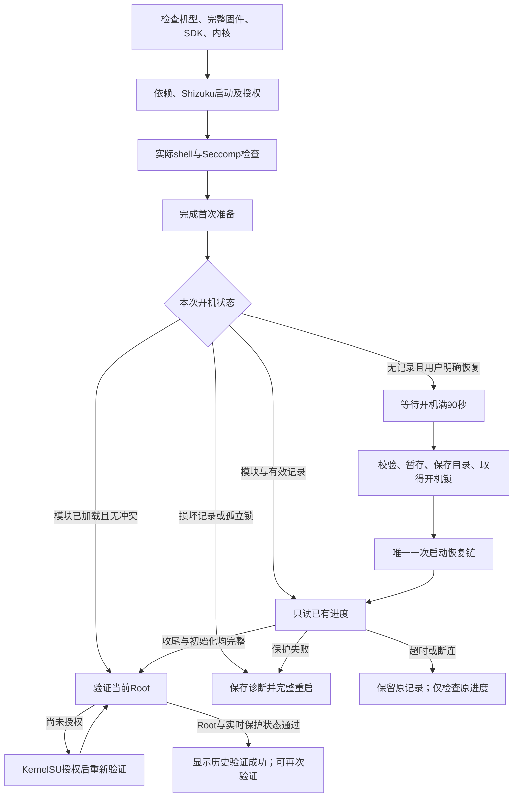

# ANB Root 2.4.0 全流程审计

本轮检查 App 全部自有 Java/AIDL、资源和 Manifest、恢复载荷调用协议、构建与发布工具、测试及当前使用文档。修复以可复现问题和明确的状态不变量为依据，不宣称有限测试能够保证任意设备故障下完全无 BUG。第三方 native 二进制保留原字节；不是一次对全部上游 native 源码的重新审计。

## 流程与任务所有权

检查、恢复、设置与管理器刷新共用一个任务租约。任何已有租约阻止第二项任务；过期任务不能释放新任务的租约。观察器、通知显示或辅助诊断失败不应中断实际恢复。恢复已启动后发生超时、断连或 App 进程退出，不代表后台原生进程停止；不能自动重跑。

| 状态 | 可继续的路径 | 禁止或失败闭环 |
|---|---|---|
| 不支持的设备、固件或内核 | 查看支持条件 | 不启动载荷 |
| 依赖缺失、Shizuku未启动或未授权 | 安装、启动、授权，再检查 | 历史成功不能覆盖当前前置条件 |
| 开机不足90秒 | 等待后重试 | 此时未启动载荷 |
| 同次开机有效运行记录 | 继续监视原目录 | 不产生第二次利用 |
| 记录损坏或丢失但开机锁存在 | 导出诊断，完整重启 | 已加载模块也不能绕过 |
| 等待KernelSU授权 | 授权后验证 | 模块丢失或保护变化不能误报授权问题 |
| 超时或断连 | 只查原进度；必要时完整重启 | 保留运行目录和锁，不自动重试利用 |
| 收尾、保护或初始化失败 | 保存诊断并完整重启 | 不显示成功、不提供再次恢复入口 |
| 验证成功 | 再次只读验证；刷新管理器 | 环境复查不能把成功或危险失败静默重置 |
| 导出、通知授权、界面重建 | 保留待执行动作和导出所有权 | 不重复写文件，不丢失完成提示 |

## 修复清单

- 在模块快速路径之前验证运行目录的开机归属及遗留锁，阻止孤立模块绕过恢复收尾判断。
- 引入 `ANB_STATUS=2`：严格读取模块、完成、Enforcing、保护收尾、四个 KernelSU 初始化阶段状态；日志尾部不能伪装状态头。
- `su` 实际成功后检查签名强制校验、kptr/panic原值、kallsyms残留挂载、hisecd停止状态和Enforcing。尚未授权时不假装这些实时检查已完成。
- 辅助诊断保存采用尽力写入；运行目录、载荷和必要偏好仍严格检查写入失败。
- 环境重新检查保留同次开机危险失败、等待授权与历史成功；模块/开机变化时清除过期证明。
- 启动线程或读取偏好失败时释放任务租约；进度和完成观察器异常不终止恢复。
- 通知权限撤销导致通知更新异常时，后台监视继续。
- 修复任务在界面采样后结束时遗漏最后观察回调的竞态，避免按钮停留在处理中；增加确定性实机回归。
- 损坏的恢复选项安全默认关闭、损坏的首次准备默认未完成；运行记录类型/格式/开机对应关系错误时拒绝启动，明确要求重启并清除应用数据重新准备。
- 通知授权和文档选择期间旋转保留待执行动作；诊断导出按进程共享所有权和结果。
- 同阶段持续刷新记录；只显示最近32,000字符，保存诊断包含完整保留缓冲区。避免切断Unicode字符。
- 计时取自实际任务租约，旋转/重新进入不重新计时；修正文案、隐私说明、固件兼容提示和普通权限故障误分类。
- 所有界面状态组合检查已有模块不得提供新恢复、危险失败不得提供恢复、忙碌/缺前置条件不得绕过门禁。
- 构建UI测试包含所有生成类并清理旧输出；发布工具拒绝重复/越界APK条目，当前core清单覆盖全部App输入。

## 验证

- `test.ps1`：9组JVM/实际引擎与Service替身回归，以及3个Python发布工具测试通过；其中界面状态检查 **16,848** 种组合。
- Android SDK 35 / build-tools 35.0.0 完整生产构建通过。五个固定依赖JAR哈希验证通过。
- 8个原载荷与AIDL与2.1.0基线字节一致；全部App源输入由当前core清单固定。
- 原设备OTA后完整固件与内核不变；用户报告仍可Root，ADB只读复核UID 0。
- 新版实际生成的状态/保护命令在本次现有Root环境返回 `MODULE=1`、`FINISHED=1`、`ENFORCE=Enforcing`、`CLEANUP=1`、`STAGES=1`、`ANB_PROTECTION=1`。
- 使用新正式证书迁移安装2.4.0，并验证同新证书覆盖安装成功。原App设置/日志/本次目录已先备份并恢复，此操作不等同于普通用户清数据迁移。
- 最终正式APK在五种实机配置通过 **1,623** 项Activity断言（322/322/346/315/318），包含确定性任务结束竞态、真实诊断I/O成功/失败、重建与权限交接。测试后字号、方向、夜间模式和density全部复核恢复。
- 最终APK由App自身验证现有Root，实际返回UID 0、`ANB_PROTECTION=1`、Enforcing及成功阶段，管理器刷新通过。安装包与发布文件SHA-256完全相同。测试包已卸载。
- 机器可读摘要见[验证记录](../release/v2.4.0-verification.json)。

## 不能夸大的边界

本轮不重复运行原生利用或完整重启。首次利用、完整重启恢复和所有第三方模块组合没有在本轮逐一复测；替身测试覆盖逻辑分支，不能替代这些硬件场景。上游脚本异常终止、系统进程死亡、内核故障或断电仍可能阻止清理，本版拒绝确认成功并要求保存诊断、完整重启。Root是临时状态，不是Bootloader解锁或永久Root。

## 签名迁移

原签名密钥未能找回，经维护者同意从2.4.0改用新发布证书。旧证书不能与新证书直接覆盖；2.3.5及更早版本先保存诊断，已有本次恢复记录时先完整重启，再卸载旧版、安装新版并重新授权和设置。不要手动删除开机锁来绕过保护。新证书指纹与安装步骤见[使用指南](USER_GUIDE.md)。
